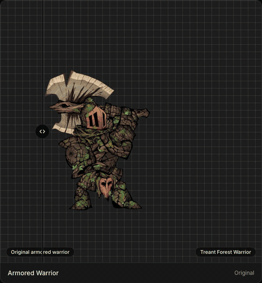
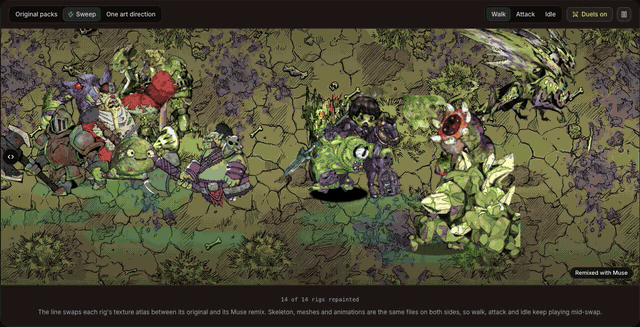
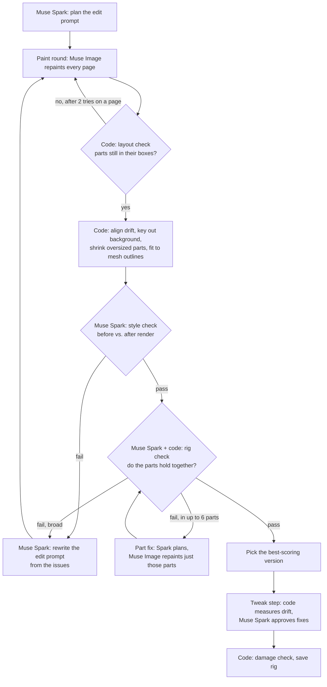
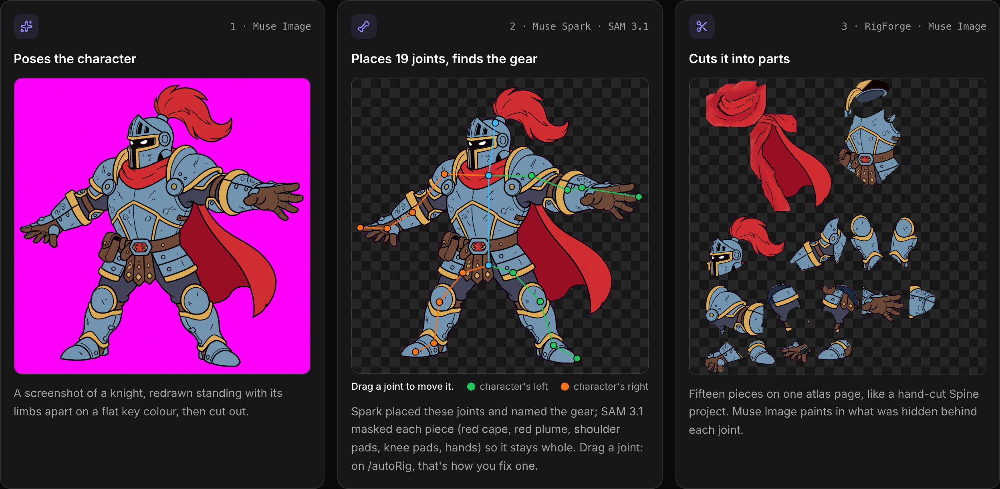
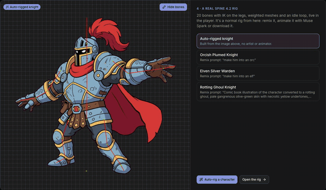
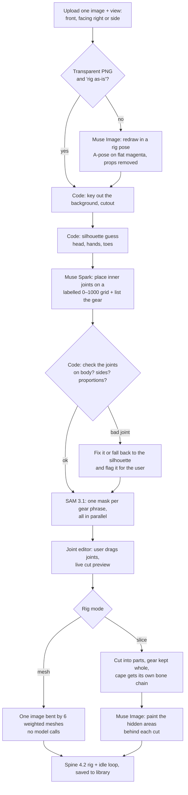
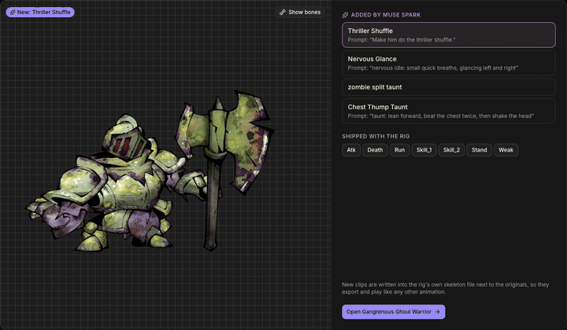
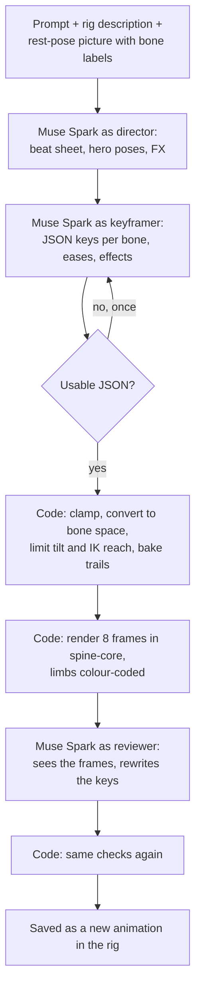
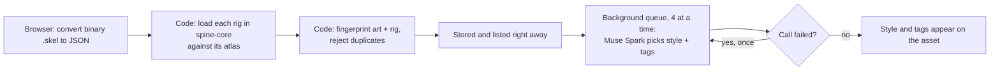
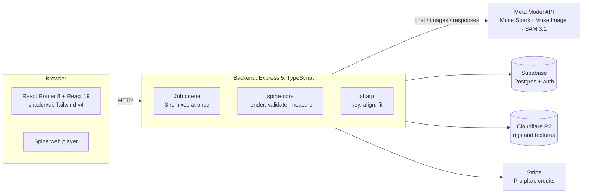

# RigForge

**Spine 2D game assets, made with Meta's models.** Browse rigged 2D characters, remix their art from a prompt, auto-rig a character from one image, generate animations from a sentence, and upload your own rigs.

<p align="center">
  <a href="https://rigforge.app"><strong>▶ Try it live at rigforge.app</strong></a>
  &nbsp;·&nbsp;
  <a href="https://rigforge.app/showcase">Showcase</a>
  &nbsp;·&nbsp;
  <a href="https://rigforge.app/remix">Remix Studio</a>
  &nbsp;·&nbsp;
  <a href="https://rigforge.app/autoRig">Auto-rig</a>
</p>

<p align="center">
  
  <br>
  <sub>One rig, five remixes. Same bones and animations; Muse Image repainted the art from a prompt.</sub>
</p>

Built for the **Meta Global AI Developer Hackathon** (Oct 27 – Nov 4, 2026). Every AI feature runs on the Meta Model API: **Muse Spark**, **Muse Image** and **SAM 3.1**.

## Judge login

To try remixing, auto-rigging and animating without a Google account, sign in at [rigforge.app/login](https://rigforge.app/login) under **Hackathon judges**:

| Username | Password |
| --- | --- |
| `judges` | `R3CafgWW8gf2gqJ8eciR5oVj` |

The account is shared and has the Pro allowance.

- [Judge login](#judge-login)
- [What it does](#what-it-does)
- [Meta models we use](#meta-models-we-use)
  - [The 7 agents](#the-agents)
  - [System prompts](#system-prompts)
- [How the agent loops work](#how-the-agent-loops-work)
  - [Remix](#1-remix-re-texture-a-rig-from-a-prompt)
  - [Auto-rig](#2-auto-rig-one-image-to-a-playable-rig)
  - [Animate](#3-animate-keyframes-from-a-sentence)
  - [Upload](#4-upload-style-tags-and-names-for-your-own-rigs)
- [Architecture](#architecture)
- [Running it locally](#running-it-locally)
- [Friction log](#friction-log)

---

## What it does

A Spine rig is a skeleton (bones, constraints and animations as JSON) plus a texture atlas: the character's parts cut apart and packed onto one or more images. RigForge works on both halves.

| Flow | You give it | You get |
| --- | --- | --- |
| **Remix** | A rig and a prompt ("make him a frost giant"), plus an optional style or reference image | The same rig with new art, still playing every animation |
| **Auto-rig** | One picture of a humanoid character | A Spine 4.2 rig with 19 joints, weighted meshes and an idle loop |
| **Animate** | A rig and a sentence ("heavy overhead axe chop") | A new animation saved into the rig, with hit flashes, trails and draw-order changes |
| **Upload** | Your own Spine rigs | Validated assets with an art style and search tags picked for you |

Every result plays in the browser with the Spine runtime and can be downloaded as standard Spine files.

## Meta models we use

All calls go to the Meta Model API at `https://api.meta.ai/v1`. Model IDs are set in [backend/src/lib/config.ts](backend/src/lib/config.ts) and can be overridden in `.env`.

| Model | Endpoint | What it does in RigForge |
| --- | --- | --- |
| **Muse Spark** (`muse-spark-1.3`) | `/chat/completions` (vision + JSON) | The planner and the judge. It plans remixes, describes styles and reference images, inspects painted results, rewrites its own prompts after a failure, places rig joints, names gear for SAM, choreographs and keys animations, reviews rendered frames, approves part tweaks, and tags uploads. |
| **Muse Image** (`muse-image-1.0`) | `/images/edits` | The painter. It repaints atlas pages and single parts, redraws an uploaded character in a rig-ready pose, and paints the hidden areas behind sliced limbs. |
| **SAM 3.1** (`sam-3.1`) | `/responses` | The segmenter. It masks each piece of gear Spark names (capes, pauldrons, kneepads, hands) so auto-rig slicing keeps them whole. Replies are decoded with `@meta-sam/parser`. |

**Muse Code** isn't on the Model API (`GET /v1/models` doesn't list it), so the backend can't call it. Animation, which we first planned for Muse Code, runs on Muse Spark instead.

### The agents

RigForge runs **7 agents**. Each one has its own job, its own prompts and its own guardrails, and the remix live view credits every step to one of them. **6 of them call Muse Spark**, through **15 distinct prompts**. One (Poser Penny) only uses Muse Image.

| Agent | Models | Used in | Muse Spark calls | What makes it different |
| --- | --- | --- | --- | --- |
| 🎬 **Director Dirk** | Muse Spark | Remix | `describeReference`, `describeStyle`, `planRemix`, `revisePlan`, `rewordForContentPolicy` | The only agent that writes *for another model*. It turns the user's words into an edit prompt for Muse Image, and it never judges its own work. After an inspector rejects a version, it rewrites the prompt from their issues, with every earlier rejected prompt attached so it doesn't undo an earlier fix. The winning version is picked by code (`scoreOf`), not by Dirk's opinion. |
| 🖌️ **Designer Dani** | Muse Image (+ Muse Spark) | Remix, part fixes, auto-rig | `planPartFix` | The painter. It repaints atlas pages, single flagged parts, and the hidden areas behind auto-rig cuts. Spark only steps in for part fixes, expanding "fix the shield" into a paint instruction that names each part by where it sits in the image. Every paint goes through a code check (layout fit, part scale) before anyone sees it. |
| 🎨 **Stylist Stella** | Muse Spark | Remix | `inspectStyle` | A judge with one question: does the assembled character have the look the user asked for? It sees code-rendered drawings of the character before and after, and returns a score and a list of issues in paint terms. Pass or fail is worked out from the score (≥ 0.7), never asked for, so the two can't disagree. |
| 🦴 **Rigger Rick** | Muse Spark (+ SAM 3.1) | Remix, auto-rig, auto-tweak | `inspectRig`, `reviewTweaks`, `reviewAutoTweak`, `sparkJoints` | Structure, not looks. It checks whether the repainted parts still hold together, and approves the fixes code measured for each part's drift. In auto-rig it places 19 joints on a labelled grid and names the gear for SAM 3.1 to mask. It's the most tightly fenced agent: its numbers are clamped, its joints are checked against body proportions, and a tweak that tears a part from its neighbour is undone. |
| 🎞️ **Animator Annie** | Muse Spark | Animate | director, keyframer, reviewer | Three passes of one agent, each with its own prompt. The director writes a beat sheet in plain text, the keyframer turns it into JSON keys with eases and effects, and the reviewer sees 8 rendered frames of its own first pass and rewrites it. It's the only agent that reviews its own output from pictures, and it runs at `reasoning_effort: "medium"`. |
| 🧍 **Poser Penny** | Muse Image | Auto-rig | — | No Spark at all. It redraws an uploaded character in a rig-ready pose (A-pose, three-quarter or side) on flat magenta, keeping its identity and removing props. |
| 📚 **Librarian Lou** | Muse Spark | Upload | `suggestTags` | Runs in the background, after the upload has already succeeded, so it can never fail one. It picks the art style and 4–8 search tags, reusing the catalogue's existing tags. For admin uploads it also picks the category and names the creature. Short structured replies run at `reasoning_effort: "low"`. |

How they work together in a v3 remix: **Dirk** plans → **Dani** paints → **Stella** checks the style → **Rick** checks the fit → **Dirk** rewrites the plan, or **Dani** fixes a few parts → **Rick** lines the parts back up. Agents never talk to each other directly. Each one's output is checked in code and passed to the next as structured data (an edit prompt, a list of issues, measured fixes), so one agent's bad reply can't derail the loop.

### System prompts

Every agent runs on its **own system prompt**, one per Muse Spark call, 15 in all. Each prompt gives the agent its role, says what it's looking at, sets the rules for its one job, and fixes the exact JSON shape it must reply with. Splitting the work this way keeps each prompt short and focused: an inspector judges only the look or only the fit, never both, and a planner writes only for the model that comes next.

The prompts share three habits:

- **Write for the next model.** Agents that write for Muse Image turn vague requests into concrete paint terms (materials, colours, surfaces) and never mention the rig or the atlas.
- **Every part is a fixed cut-out.** Prompts keep the models from "completing" pieces, such as painting a face into a helmet or a foot onto a shin. Most of these rules trace back to a failure in the [friction log](FRICTION_LOG.md).
- **Replies are untrusted.** Every reply is parsed and checked in code: unknown parts are dropped, numbers are clamped, and an unusable reply falls back to a safe default.

Every Meta call's token use is recorded per job from the response's `usage` field and billed as credits, so a failed job costs nothing ([backend/src/v3/lib/meta.ts](backend/src/v3/lib/meta.ts), `recordModelCalls`).

### The pattern behind every flow

Image models are good at painting and bad at staying in place. Language models can see what went wrong but can't measure it. So each flow splits the work three ways:

1. **Muse Spark plans** and turns the user's words into precise instructions.
2. **Muse Image or SAM does the pixel work.**
3. **Code measures** what the model returned (layout drift, part sizes, joint proportions, limb reach), and **Muse Spark judges** what code can't measure (does it look like a frost giant? does the chop land?).

When a check fails, the loop feeds the problem back as a rewritten prompt, a targeted fix or a retry, and it always has a code fallback, so a bad model reply never becomes a broken rig.

---

## How the agent loops work

### 1. Remix: re-texture a rig from a prompt

Remixes run on **v3**, the self-checking pipeline: Muse Spark plans, Muse Image paints, and then Spark inspects the result and repairs it in a loop until its checks pass. The remix page also offers **v2**, the same plan-and-paint step run once with no inspection (faster, and half the credits), and v1, the first version, kept for comparison.

Code: [backend/src/v3/lib/remix.ts](backend/src/v3/lib/remix.ts) (`runRemix`), model calls in [backend/src/v3/lib/meta.ts](backend/src/v3/lib/meta.ts).

<p align="center">
  
  <br>
  <sub>14 rigs from different packs, remixed into one art direction. The line swaps each rig's atlas mid-stride.</sub>
</p>

#### Setup

1. **Read the rig.** Parse the atlas, decode every page, and lay the parts out in a fixed square so every model call sees them in the same positions.
2. **Pick a key colour.** Muse Image can't return transparency, so each page is painted on a solid background colour the art doesn't use, then keyed back out.
3. **Study the reference** (optional). Muse Spark describes an uploaded reference image on its own, in paint terms (`describeReference`). Muse Image never sees it, because it repaints the reference instead of the atlas.
4. **Plan.** Muse Spark looks at the atlas pages, the part list and the prompt, and writes the edit prompt for Muse Image (`planRemix`). A named style ("Black Clover") is described in a separate Spark call (`describeStyle`), which recalls a style far better than it does inside the plan.

#### The loop



**Paint round.** Muse Image repaints each page. Later pages also get the first repainted page as a second image, so multi-page rigs stay consistent. After each call, code measures how much of the painted pixels land inside the parts' boxes (`layoutFit`). Below 85%, the model has redrawn the layout instead of repainting in place, so the page is painted once more with a "keep every part where it is" note. If that fails too, the round is thrown out and repainted with the same plan. A page that passes is aligned to undo the model's few-percent drift (`alignGenerated`), keyed out, and has any part drawn bigger than its box shrunk to fit. If Muse Image rejects the prompt under its content policy, Spark rewords it once (`rewordForContentPolicy`) and painting continues.

**Style check.** Code assembles the character from the repainted pages in the Spine runtime and draws it next to the original. Muse Spark compares the two drawings with the request and returns a score, a summary and a list of issues (`inspectStyle`). The style is checked first, because a wrong look means repainting everything, so there's no point fixing joints yet.

**Rig check.** Muse Spark judges whether the repainted parts still hold together as one character (`inspectRig`). Code adds problems it can measure even when Spark misses them: parts that had to shrink below 50% to fit, and parts the game would cut off at a mesh outline (`withPartProblems`).

**Repair.** The kind of failure decides the repair:
- **A problem in a few named parts** (6 or fewer) goes to a **part fix**. Spark expands the issue into a paint instruction (`planPartFix`), and Muse Image repaints only those parts, with their neighbours drawn as off-limits shapes so they aren't painted over. The fixed version is checked again, up to 2 part fixes per round.
- **A wrong style or a broad rig problem** goes to Muse Spark, which **rewrites its own edit prompt** from the issues (`revisePlan`). Every rejected prompt is passed along, so a revision doesn't undo an earlier one. The whole sheet is then repainted.

**Stopping and scoring.** Every version is scored. A version that passed the style check always outranks one that failed it:

```
style failed:  score = style / 2
otherwise:     score = 0.5 + (style + rig) / 4
```

The loop stops when both checks pass (score ≥ 0.7, `SHIP_SCORE`), when a round doesn't beat the best so far, after 2 inspected rounds (3 paint rounds counting thrown-out ones), or after 8 minutes. The best version ships. If it didn't clear the bar, the live view warns the user.

**Tweak step.** Repainted parts are often a little off-centre or the wrong size, even when they look right. On the chosen version:
1. **Measure (code).** The original and the remix are drawn in the same pose, and each part's offset, scale and rotation fix is measured from its pixels (`measureFixes`).
2. **Approve (Muse Spark).** Spark sees three numbered drawings (original, remix, remix with the measured fixes) and keeps, drops or adjusts each fix. It may also nudge parts that couldn't be measured, within tight limits (`reviewTweaks`). Spark's reply is untrusted: unknown parts are dropped and every value is clamped.
3. **Damage check (code).** A tweak that pulls a part away from a neighbour it used to touch is undone (`lostContacts`).

The tweaks are written into the rig's skeleton JSON. The same measure-then-approve idea powers the **auto-tweak** button on the remix page ([backend/src/lib/auto-tweak.ts](backend/src/lib/auto-tweak.ts)), where the browser does the measuring.

**Live view.** Every step emits an event (planned, painted, rejected, checked, revised, chosen, tweaked) that the page streams into a timeline, with each painted page, each rejected attempt and each inspector verdict ([frontend/app/components/RemixLiveView.tsx](frontend/app/components/RemixLiveView.tsx)). Each round's files and a `prompts.json` of every check are saved for debugging.

**Part fixes on their own.** Users can also pick parts on a finished remix and describe a fix. This runs the part-fix step outside the loop ([backend/src/v2/lib/part-fix.ts](backend/src/v2/lib/part-fix.ts)). It has its own check: at least 85% of the paint must touch the chosen parts, and no part may need to shrink below 50% (25% when it's well placed). A failed check is repainted once with a corrective note.

### 2. Auto-rig: one image to a playable rig

Code: [backend/src/lib/autorig/](backend/src/lib/autorig/), entry point [create.ts](backend/src/lib/autorig/create.ts). Design notes: [AUTO_RIG_PLAN.md](AUTO_RIG_PLAN.md).

<p align="center">
  
  <br>
  <sub>Muse Image poses the character, Muse Spark places the joints and names the gear, SAM 3.1 masks it, and the rig is cut into parts.</sub>
</p>

<p align="center">
  
  <br>
  <sub>The finished rig plays like any Spine rig, and can be remixed: orc, elf and ghoul versions of the same auto-rigged knight.</sub>
</p>



**Prepare.**
1. **Pose (Muse Image).** The upload is redrawn as a full-body character sheet in a rig-ready pose for the chosen view: a front A-pose, a three-quarter view facing right, or a strict side profile. The prompt keeps the character's identity, removes weapons and floating props, and asks for flat magenta, which keys out cleanly. Muse Image ignores the requested size and returns a 1600×1600 WebP, so the reply is decoded by content, not by extension ([pose.ts](backend/src/lib/autorig/pose.ts)). A transparent PNG that's already in a good pose can skip this step.
2. **Joints (code, then Muse Spark, then code).** The silhouette finder places the extremities well (head top, fingertips, toes) and the inner joints badly (shoulders under pauldrons, hips under a loincloth). Muse Spark gets the cutout on a labelled 0–1000 grid, with the silhouette's guess, and places the 19 joints at the pivot inside the body. The same call lists the character's gear as short phrases a segmenter knows ("red cape", "knee pad"), each with the body part it moves with ([spark-joints.ts](backend/src/lib/autorig/spark-joints.ts)).
3. **Validation (code).** Spark's joints are checked before anyone sees them: joints off the body, limbs that fold back on themselves, swapped left and right, a hip far from the pelvis's height, a thigh under 0.55× its shin, upper-to-lower arm ratios outside 0.5–2.5. Bad joints are corrected or fall back to the silhouette, and are flagged in the editor. If Spark fails completely, the whole rig uses the silhouette's guess. This check exists because Spark once put a knight's hips at knee height twice (see the friction log).
4. **Gear masks (SAM 3.1).** Each gear phrase, plus "hand", is a separate SAM call, all sent at once. If a pad's own phrase finds nothing, a plain fallback phrase is tried ("knee pad" found kneepads that "knee armor" missed). Masks below 0.5 confidence, or too small or too big for the character, are dropped. If SAM fails, slicing falls back to distance alone ([gear.ts](backend/src/lib/autorig/gear.ts)).

**Human in the loop.** The joint editor shows the cutout with every joint draggable, the flagged ones outlined, and a live preview of where the rig will cut. Every drag re-runs the cut preview on the backend against the saved pose and gear masks.

**Build.** Every rig gets the same 19-joint skeleton with foot IK, so animations and checks treat all rigs alike ([rig.ts](backend/src/lib/autorig/rig.ts)).
- **Mesh mode (default).** The art stays one image, bent by six weighted meshes. Each pixel goes to its nearest bone by distance *through the silhouette*, so one leg never takes pixels from the other. No model calls. Best for gentle motion.
- **Slice mode.** The art is cut into separate parts for big motions. SAM's gear masks override the distance rule, so a pauldron goes whole with the upper arm and a cape becomes its own piece on a three-bone chain that sways. Cutting exposes areas that were hidden behind other parts. Code smears colour into them, then **Muse Image paints them properly** ([muse-fill.ts](backend/src/lib/autorig/muse-fill.ts)). The image endpoint has no mask, so the hidden areas are painted one flat marker colour the character doesn't use. Muse redraws the whole sheet, and code keeps only its pixels inside the hidden areas, and only where the colour already exists in that piece's own art. Everything else keeps the smear.

Each step saves a trace of every model call and decision (`prepare.json`, `autorig.json`), so a bad rig can be traced back to the call that caused it.

### 3. Animate: keyframes from a sentence

Code: [backend/src/lib/animate.ts](backend/src/lib/animate.ts) (`animateSkeleton`), with [animate-render.ts](backend/src/lib/animate-render.ts) and [animate-fx.ts](backend/src/lib/animate-fx.ts).

<p align="center">
  
  <br>
  <sub>Four animations Muse Spark keyframed onto a rig that shipped with only an attack, a run and a death.</sub>
</p>

A Spine animation is a set of sparse keyframes per bone that the runtime interpolates, so a language model can write a whole one in a single reply. Asked to do it in one go, Spark wrote small, evenly timed, softly eased motion. Splitting the job into a director, a keyframer and a reviewer made it bold.



1. **Read the rig (code).** The skeleton is turned into text Spark can reason about: every bone, where it sits and which way it points, which bones are driven by IK or other constraints, how the rig's own animations move, and which slots can swap attachments. The page also sends a rest-pose picture with every bone labelled, plus frames of the rig's own attack, so Spark can see which way the character faces and which bone holds the weapon.
2. **Direct (Muse Spark).** The director prompt asks for a beat sheet under 300 words: which way the character faces, the energy of the motion, timed beats (anticipation, a fast action, an impact hold, follow-through, settle), 2–4 exaggerated hero poses, overlap between chained bones, and which effects sell it. The prompt includes 2D action-animation practice such as hit-stop, line of action, arcs and squash-and-stretch.
3. **Keyframe (Muse Spark).** The keyframer turns the beat sheet into JSON: per-bone rotate, move, scale and shear keys, each with an ease (`snap`, `settle`, `smooth`, `linear`). Limbs can be keyed as screen-space *aims* ("forearm points at 0°") instead of rotations. Optional effects are hit flashes, slot tints and fades, attachment swaps, draw-order changes and glowing weapon trails. An unusable reply is retried once with a "JSON only" note.
4. **Check (code).** The keys are validated against the real rig. Unknown or constraint-driven bones are dropped with a reason, values are clamped, aims are converted into each bone's local rotation, torso tilt is scaled back to within 45°, and IK targets are pulled back within 92% of the chain's reach (Spark once spread a ghoul's feet to 153% of its legs). Trails are baked by playing the animation in the Spine runtime.
5. **Review (Muse Spark sees its own work).** Code renders 8 frames of the first pass with spine-core. The art is drawn as flat shapes coloured by limb, over a faint outline of the rest pose and a ground line. Spark gets those frames, its first reply and the list of automatic fixes. Reviewing like a lead animator, it checks direction, size, which parts lead, foot contact, balance and timing, then sends the whole animation again. The new keys go through the same code checks. If the review fails, the first pass is kept, and the review is skipped when the first two calls already took over 5 minutes.

Both Spark calls use `reasoning_effort: "medium"` (`ANIMATE_REASONING_EFFORT`). **Editing** an existing animation runs the same pipeline, but both prompts get the current motion sampled from the runtime and an instruction to change only what was asked. Every run's requests, replies and rendered strips are saved locally.

### 4. Upload: style, tags and names for your own rigs

Code: [backend/src/lib/uploads.ts](backend/src/lib/uploads.ts), [upload-tags.ts](backend/src/lib/upload-tags.ts), [upload-rename.ts](backend/src/lib/upload-rename.ts).



1. **Validate (code).** The page converts binary `.skel` files to JSON in the browser. The backend loads every rig with the Spine runtime against its atlas before storing anything, so a rig missing a region or page is rejected with the reason.
2. **Deduplicate (code).** Each rig is fingerprinted by its art (page PNGs) and its skeleton. A rig whose art and skeleton both match an existing public rig is rejected. New art on an existing rig, or new animations on existing art, counts as new work and is credited to the original.
3. **Tag (Muse Spark, in the background).** After the rigs are stored, a shared queue (4 calls at a time) sends each rig's atlas pages, name, bone names, animation names and the catalogue's existing tags to Muse Spark. It picks the art style (cartoon, anime, pixel, painterly or flat) and 4–8 search tags, reusing existing tags spelled exactly as listed, so the catalogue doesn't fill up with near-duplicates. Rig features the pictures can't show (IK, meshes, physics, skins) are read from the skeleton in code. Calls use `reasoning_effort: "low"`, because Spark otherwise reasons for a minute over a short structured reply.
4. **Retry and fall back.** In a 62-rig batch about 1 in 8 calls failed and succeeded on a retry, so a failed call is retried once after 5 seconds. If it fails again, the rig keeps the default style and no tags. The upload itself never fails because of a model call.
5. **Name and categorise (admin uploads).** For admin bulk uploads, Spark also picks a category (an existing one, or a new one when none fits) and names the creature, avoiding existing names. The files are then stored again under that name, with the atlas's page lines rewritten to match.

---

## Architecture



| Folder | What it is |
| --- | --- |
| [frontend/](frontend/) | React Router v8 (framework mode), React 19, shadcn/ui, Tailwind v4, Spine web player |
| [backend/](backend/) | Express 5 API in strict TypeScript. Runs every model call, plus image processing with `sharp` and headless Spine posing with `@esotericsoftware/spine-core` |
| [backend/src/v3/](backend/src/v3/) | The self-checking remix loop (the default) |
| [backend/src/lib/autorig/](backend/src/lib/autorig/) | Auto-rig: pose, joints, gear masks, mesh building, hidden-area fill |
| [supabase/migrations/](supabase/migrations/) | Database schema: assets, remix jobs, versions, credits |

Long model work runs as background jobs. The page polls for progress and streams the live view. At most 3 remixes or part fixes run at once (`MAX_RUNNING_JOBS`), because each job fires many Meta calls in parallel. A whole job is capped at 30 minutes, a Spark call at 5 and an image call at 20.

## Running it locally

```bash
npm install            # every workspace, one lockfile
cp backend/.env.example backend/.env   # add META_API_KEY, Supabase, R2 and Stripe keys
npm run dev            # frontend on :5173, backend on :4000
npm run typecheck
npm test               # backend regression fixtures in backend/test/
npm run db:push        # apply supabase/migrations/ (needs the Supabase CLI)
```

Only `META_API_KEY` is needed for the model calls. Without R2, generated files are stored on disk. Without Stripe, billing routes return 503.

## Friction log

[FRICTION_LOG.md](FRICTION_LOG.md) records where building on Meta's models went slower than it should have, with the endpoint, model, request and response for each entry. Highlights: Muse Image can't return transparency, has no mask or strength parameter on `/images/edits`, ignores `size`, and drifts parts by a few percent. Almost every code check in the loops above exists because of one of those entries.
